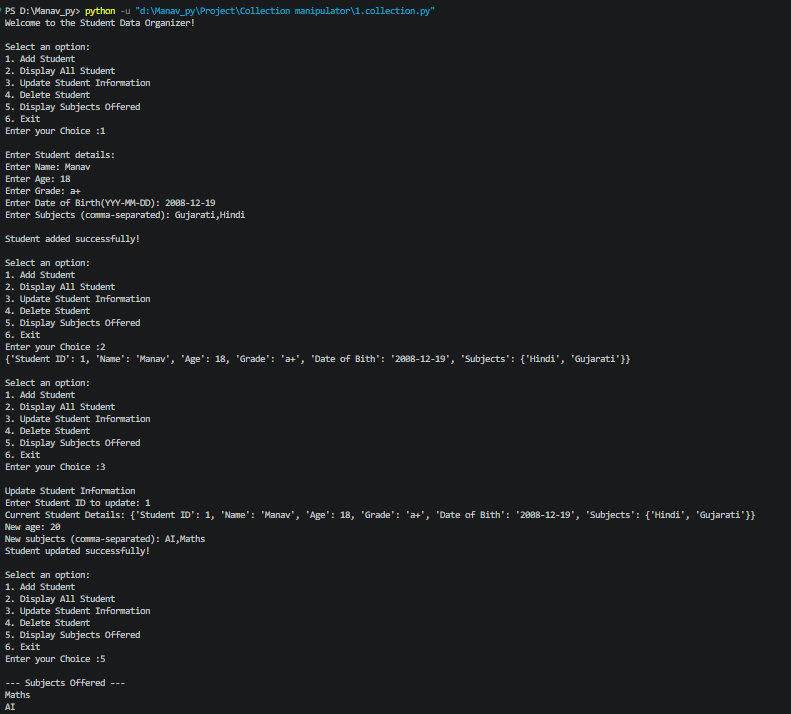
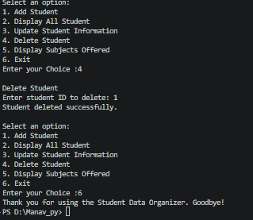

# Student Data Organizer

Student Data Organizer is a menu-driven Python program that helps manage
student records. It allows users to add, display, update, and delete
student details using a Student ID, as well as view the unique subjects
offered. The project uses Python concepts such as lists, dictionaries,
sets, loops, and match-case statements.

## Output

